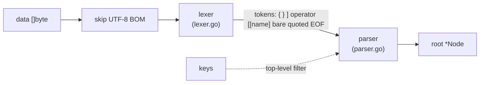
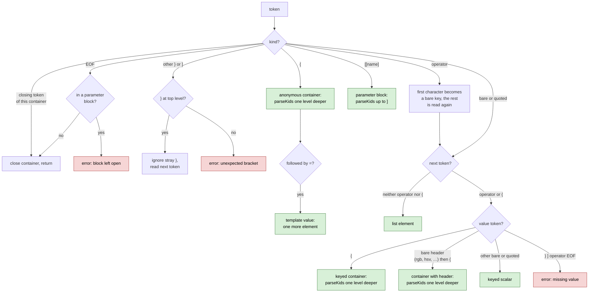

# How the parser works

The accepted syntax and the API are described in the package documentation (`go doc -all github.com/doranych/clausewitz-parser`). This page covers how `Parse` turns bytes into a tree.

## Overview

There are two stages. They run together in one pass: the parser pulls tokens from the lexer one at a time.

1. **Lexer** splits the input into tokens.
2. **Parser** groups tokens into entries and builds `Node`s.

Neither stage copies the input. `Key` and `Val` of every node are slices of `data`, and only the `Node` structs and their `Kids` slices are allocated.

## Lexer

The lexer reads `data` from left to right and returns these tokens:

| Token | Input |
|---|---|
| open, close | `{`, `}` |
| close parameter | `]` |
| operator | `=`, `==`, `<`, `<=`, `>`, `>=`, `!=`, `?=` |
| parameter | `[[name]` or `[[!name]`, holding `name` or `!name` |
| quoted | a string in `"`, holding the bytes between the quotes with escapes left in place |
| bare | anything else, up to whitespace or one of `; # { } [ ] = < > ! "` |
| end of file | |

- Whitespace and `;` are skipped. `#` skips to the end of the line.
- A quoted string runs to the next `"` that does not follow a backslash.
- A bare value that starts with `@[` or `@\[` runs to the next `]`, so inline maths with spaces inside is one token.
- `?` is a delimiter only in `?=`, which matches jomini: `c:RUS ?= this` is an operator, while `a?b` is one bare value.
- A lone `!` and a `[` that does not start `[[` are errors.

The parser sometimes needs to see the next token before deciding what the current one is. For this the lexer has `peek`, which reads one token ahead and returns it again on the next `next`.

Line breaks are ordinary whitespace, so the lexer is unaffected by broken indentation or several entries on one line.

## Parser

The parser is recursive descent: `parseKids` reads the entries of one container until its closing token, and calls itself for each nested container. It is told which token closes the container:

- the end of the file for the root;
- `}` for a container opened with `{`;
- `]` for a parameter block opened with `[[name]`.

For each token inside a container the parser decides as below. Every green box adds a child and moves on to the next token; the red boxes stop parsing with an error.

The operator between a key and its value goes to `Op`, except `=`, which leaves `Op` empty.

A parameter block becomes a node with `Key` set to the name and `Param` set to `ParamSet`, or `ParamUnset` for `[[!name]`. When the block holds a single list element, as in `[[effect] $effect$ ]`, that value moves to the block's `Val` and the block becomes a scalar.

An object template such as `{ a=b }={ 1 2 }` has a container where a key would be. jomini reads it as two list elements, the template and its value, and so does this parser: after an anonymous container, a following `=` is consumed and the next value is added as one more element.

When a container closes, at its closing token or at the end of the file, the parser removes empty anonymous `{}` children if the container also has keyed children. In a container of list elements only they stay.

`parseKids` checks the depth before each nested container and returns an error past 256 levels. Without this limit, input such as a long run of `{` would exhaust the stack.

## Selective parsing

When `Parse` gets keys, the parser applies a filter at the top level only:

- an entry whose key is in `keys` is built as usual, including everything inside it;
- any other top-level entry is skipped: a scalar is dropped, and a container is consumed by `skipBlock`;
- top-level list elements and anonymous containers are skipped too;
- a parameter block is built and then dropped unless its name is in `keys`; parameter blocks appear in script files, which are small.

`skipBlock` reads tokens and counts `{` and `}` until the matching `}`, without building nodes. It works on tokens rather than raw bytes so that braces inside quoted strings and comments are not counted. A side effect is that an unterminated string inside a skipped section is still reported.

## Errors

Errors carry the byte offset in `data` where the problem was found. The parser stops at the first error and returns no tree.

| Case | Example |
|---|---|
| key with an operator and no value | `a=}`, `a<`, `a=` at the end of the file |
| unterminated string | `a="b` |
| unterminated inline maths | `a=@[b` |
| `!` without `=`, single `[` | `a ! b`, `a={ [b] }` |
| `]` outside a parameter block, `}` inside one, block left open | `a={ b ] }`, `[[p] a=b }`, `[[p] a=b` |
| nesting deeper than 256 levels | `a={{{{…` |

Everything else in the input produces a tree. That includes the malformed files the games load: stray `}` at the top level and containers left open at the end of the file.
