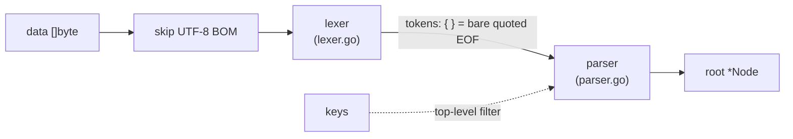
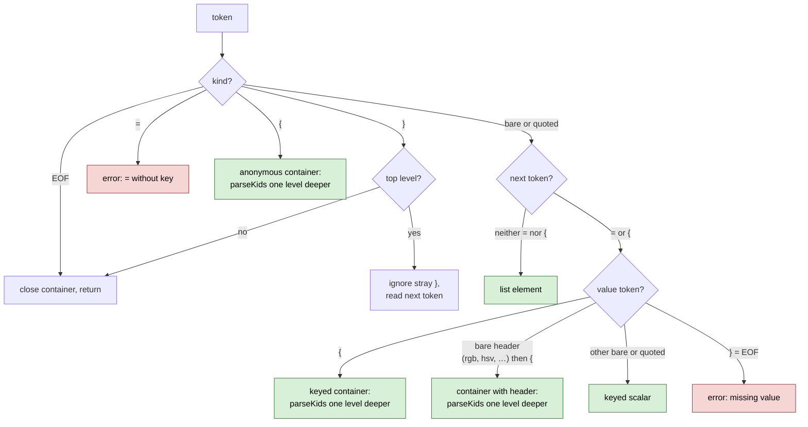

# How the parser works

The accepted syntax and the API are described in the package documentation (`go doc -all github.com/doranych/clausewitz-parser`). This page covers how `Parse` turns bytes into a tree.

## Overview

There are two stages. They run together in one pass: the parser pulls tokens from the lexer one at a time.

1. **Lexer** splits the input into tokens.
2. **Parser** groups tokens into entries and builds `Node`s.

Neither stage copies the input. `Key` and `Val` of every node are slices of `data`, and only the `Node` structs and their `Kids` slices are allocated.

## Lexer

The lexer reads `data` from left to right and returns six kinds of token: `{`, `}`, `=`, a quoted string, a bare value and end of file.

- Whitespace and `;` are skipped. `#` skips to the end of the line.
- A quoted string runs to the next `"` that does not follow a backslash. The token holds the bytes between the quotes, with escapes left in place.
- A bare value runs until whitespace or one of `; # { } = "`.

The parser sometimes needs to see the next token before deciding what the current one is. For this the lexer has `peek`, which reads one token ahead and returns it again on the next `next`.

Line breaks are ordinary whitespace, so the lexer is unaffected by broken indentation or several entries on one line.

## Parser

The parser is recursive descent: `parseKids` reads the entries of one container until its `}`, and calls itself for each nested container. The root is a container with no key that ends at the end of the file.

For each token inside a container the parser decides as below. Every green box adds a child and moves on to the next token; the red boxes stop parsing with an error.

When a container closes, at its `}` or at the end of the file, the parser removes empty anonymous `{}` children if the container also has keyed children. In a container of list elements only they stay.

`parseKids` checks the depth before each nested container and returns an error past 256 levels. Without this limit, input such as a long run of `{` would exhaust the stack.

## Selective parsing

When `Parse` gets keys, the parser applies a filter at the top level only:

- an entry whose key is in `keys` is built as usual, including everything inside it;
- any other top-level entry is skipped: a scalar is dropped, and a container is consumed by `skipBlock`;
- top-level list elements and anonymous containers are skipped too.

`skipBlock` reads tokens and counts `{` and `}` until the matching `}`, without building nodes. It works on tokens rather than raw bytes so that braces inside quoted strings and comments are not counted. A side effect is that an unterminated string inside a skipped section is still reported.

## Errors

Errors carry the byte offset in `data` where the problem was found. The parser stops at the first error and returns no tree.

| Case | Example |
|---|---|
| `=` with no key | `=1` |
| key with `=` and no value | `a=}`, `a=` at the end of the file |
| unterminated string | `a="b` |
| nesting deeper than 256 levels | `a={{{{…` |

Everything else in the input produces a tree. That includes the malformed files the games load: stray `}` at the top level and containers left open at the end of the file.
